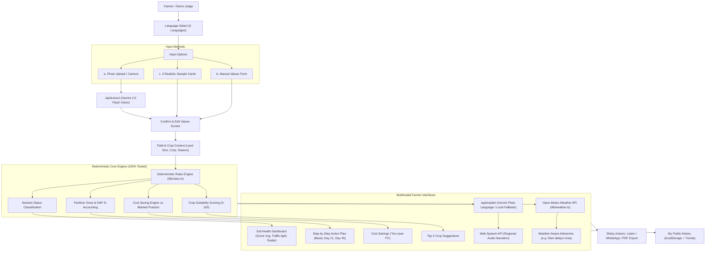

# KrishiSaathi (कृषिसाथी) - Soil Report to Action Plan
> *"Soil data that farmers act on."*

KrishiSaathi translates complex soil test reports (such as India's Soil Health Card) full of cryptic chemical numbers into a simple, local-language, voice-enabled, money-saving action plan for smallholder farmers.

---

## 🌾 The Problem
India's Soil Health Card Scheme has distributed over 230 million cards. However, reports are filled with laboratory numbers like `pH: 7.9`, `Avail P: 36 kg/ha`, `EC: 1.65 dS/m`, which smallholder farmers cannot easily interpret. As a result, farmers continue blanket habits—typically applying 2 bags of Urea and 1 bag of DAP per acre regardless of what the soil actually contains. This causes:
1. **Severe over-fertilization & nutrient lockup**: Wasting thousands of rupees on fertilizers the soil already has in excess.
2. **Soil degradation**: Increased salinity, soil acidification, and loss of soil microbial life.
3. **Yield reduction**: Crops lodge or suffer from micronutrient deficiencies (e.g. Zinc deficiency causing Khaira disease in paddy).

## 💡 The Solution
KrishiSaathi provides an end-to-end, mobile-first, zero-crash progressive web app that:
1. **Scans or accepts soil cards**: Extracts parameters via Gemini 2.0 Flash Vision or loads 3 realistic Indian agro-ecological samples.
2. **Deterministic Agronomic Rules Engine**: Classifies soil parameters and computes exact crop fertilizer requirements according to Indian ICAR / State Agricultural University guidelines.
3. **Accounts for DAP Nitrogen Offset**: Deducts the 18% N provided by DAP before computing required Urea, preventing nitrogen burns.
4. **Hero Cost-Saving Engine**: Calculates exact rupee savings compared to blanket farmer practice, highlighting **"DO NOT ADD"** red alert cards whenever nutrients are already saturated.
5. **Weather-Aware Advisories**: Live Open-Meteo forecast checks for heavy rainfall in the next 3 days, warning farmers: *"Delay urea. Rain will wash it away."*
6. **Voice-Enabled in 6 Regional Languages**: Speaks the plan aloud natively using the Web Speech API in English, हिन्दी (Hindi), తెలుగు (Telugu), தமிழ் (Tamil), मराठी (Marathi), and ಕನ್ನಡ (Kannada).
7. **Actionable Sharing**: One-tap pre-formatted WhatsApp sharing and downloadable printable PDF report.

---

## 🏛️ System Architecture



---

## 🚀 Getting Started

### Prerequisites
- Node.js 18.x or 20.x+
- npm or yarn

### Installation
```bash
# 1. Clone repository or navigate to project directory
cd krishisaathi

# 2. Install dependencies
npm install

# 3. Configure Environment Variables
cp .env.example .env.local
# Add your GEMINI_API_KEY from https://aistudio.google.com/ (optional for demo)

# 4. Run Vitest Unit Tests
npm test

# 5. Start Development Server
npm run dev
```

Open [http://localhost:3000](http://localhost:3000) in your browser.

---

## ⚡ 60-Second Judge Demo Mode
Top-right corner includes a **"⚡ 60s Demo"** button:
1. Auto-loads **Sample 1 (Punjab Wheat Field)** with high phosphorus.
2. Automatically navigates through the entire flow:
   - **Verified Soil Card**: Available P is high (36 kg/ha).
   - **Soil Health Dashboard**: Score 82/100, radar chart, and nutrient traffic lights.
   - **Action Plan**: Demonstrates the **"DO NOT ADD DAP"** red card and split application schedule.
   - **Cost Savings**: Shows **₹2,700 saved on DAP** with animated counter and bar chart.
   - **Voice**: Reads the advice aloud in Hindi, Telugu, or English.
   - **Export**: One-click WhatsApp sharing and PDF download.

---

## 🧪 Realistic Sample Cards Included
| Sample | Region | Soil & Nutrient Profile | Key Agronomic Advice & Hero Highlight |
|---|---|---|---|
| **Sample 1** | Ludhiana, Punjab | Alluvial, pH 7.9, Low N, High P (36 kg/ha), Medium K | **Save ₹2,700 by skipping DAP!** Soil has abundant phosphorus from past over-fertilization. |
| **Sample 2** | Cuttack, Odisha | Coastal Laterite, Acidic (pH 5.2), Low OC, Zinc Deficient (0.42 ppm) | Recommends **Agricultural Lime (CaCO3)** to neutralize acidity and **Zinc Sulphate** to prevent Khaira disease. |
| **Sample 3** | Akola, Maharashtra | Black Cotton Soil, Alkaline (pH 8.3), Slight Salinity (EC 1.65), High Potash (340 kg/ha) | Recommends **Agricultural Gypsum** for soil drainage reclamation and **skipping MOP** to save ₹1,700/bag. |

---

## 🌿 Technical Highlights & Standards

### 1. Indian Soil Health Card Threshold Standards (`data/thresholds.ts`)
- **pH**: `<6.5` Acidic; `6.5-7.5` Neutral (ideal); `7.5-8.5` Alkaline; `>8.5` Strongly alkaline
- **EC (dS/m)**: `<1.0` Safe; `1.0-2.0` Slightly saline; `>2.0` Saline
- **Organic Carbon (%)**: `<0.5` Low; `0.5-0.75` Medium; `>0.75` High
- **Available N (kg/ha)**: `<280` Low; `280-560` Medium; `>560` High
- **Available P (kg/ha)**: `<10` Low; `10-25` Medium; `>25` High
- **Available K (kg/ha)**: `<108` Low; `108-280` Medium; `>280` High
- **Micronutrients (ppm)**: Sulphur `<10`, Zinc `<0.6`, Iron `<4.5`, Copper `<0.2`, Manganese `<1.0`, Boron `<0.5`

### 2. Fertilizer Math & DAP Accounting (`lib/fertilizer.ts`)
- DAP contains **18% N** and **46% P2O5**.
- Urea contains **46% N**.
- When DAP is applied for phosphorus, KrishiSaathi computes the nitrogen supplied by DAP and subtracts it before calculating urea bags:
  $$\text{Net N Needed} = (\text{Target N} \times \text{Area}) - (\text{DAP kg} \times 0.18)$$
  $$\text{Urea kg} = \frac{\text{Net N Needed}}{0.46}$$
- If soil phosphorus is HIGH, DAP is set to 0 ("DO NOT ADD").

### 3. Cost-Saving Baseline (`data/prices.ts`)
- Subsidized MRP defaults: Urea 50kg = ₹270, DAP 50kg = ₹1350, SSP 50kg = ₹450, MOP 50kg = ₹1700.
- Typical blanket practice: 2 bags Urea + 1 bag DAP per acre.
- Price editor allows farmers or judges to adjust local bag prices with live recalculation.

### 4. Zero-Crash Fallbacks (`app/api/extract`, `app/api/explain`)
- If the Gemini API key is missing or internet is disconnected:
  1. The vision OCR automatically falls back to sample datasets.
  2. The natural language explanation uses comprehensive pre-translated templates across all 6 languages.
  3. The rules engine runs 100% locally in the browser.

---

## 📋 Architectural Decisions & Assumptions

| Area | Decision Made | Rationale |
|---|---|---|
| **Area Units** | Both Acre and Hectare supported with toggle (1 ha = 2.471 ac). | Indian land records often quote either acres (revenue) or hectares (official SHC). |
| **Fertilizer Bags** | Calculated in standardized 50 kg bags. | Indian commercial fertilizers (Urea, DAP, MOP, SSP) are packaged and sold in 50 kg or 45 kg subsidized bags. |
| **No Database** | LocalStorage persistence with exportable PDF / WhatsApp. | Smallholder farmers prioritize instant utility with zero account creation or password friction. |
| **Speech Engine** | Client-side Web Speech API with regional speech codes (`hi-IN`, `te-IN`, `ta-IN`, `mr-IN`, `kn-IN`, `en-IN`). | Enables completely free, offline-capable spoken narration on Android phones without third-party cloud audio billing. |
| **Offline First** | PWA manifest + Service worker caching rules, UI, and samples. | Agricultural fields in rural India frequently face 2G/3G connectivity drops. |

---

## 🔮 Limitations & Future Scope
- **Vernacular Audio Quality**: Built-in browser speech synthesis voice naturalness varies depending on the Android device's installed text-to-speech engine. Future versions can offer pre-recorded voice prompts or server-side regional neural audio.
- **KVK & Agriculture Officer Dashboard**: Future integration with government KVK portals for official agronomist sign-off.
- **Satellite Soil Moisture (NDVI)**: Adding Sentinel-2 satellite vegetation index overlays for hyper-local micro-climate insights.

---

## ⚖️ Disclaimer
*Advice provided by KrishiSaathi is indicative based on input soil test parameters. Farmers should verify with their local Agriculture Officer or Krishi Vigyan Kendra (KVK).*
